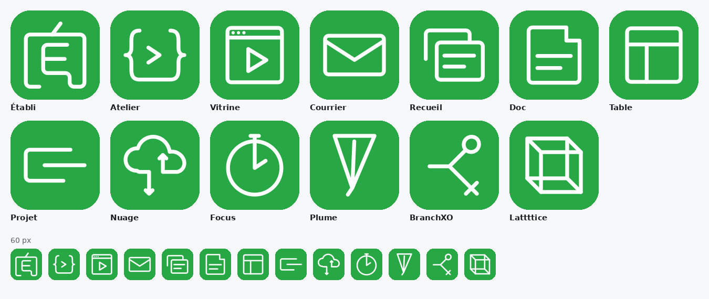

# Établi icon generator

Single source for every Établi app icon. Each glyph is defined once in `glyphs.py`
(one-line drawings in 1024 px coordinates) and rendered to every platform format.



## Spec

Also recorded in `etabli-vitrine/design/coder-design-system.json` → `icon.glyph`.

- Tile: Établi green `#28A745`, square master (the OS applies the corner mask).
- Glyph: white **one-line drawing**: one continuous main stroke with rounded corners, plus at most
  one or two small detached marks.
- Size: outer extent ≈70% of the tile (≈720 px of 1024); square glyphs optically reduced to 660–680 px (`OPTICAL` in `iconlib.py`).
- Stroke: 44 px @1024, round caps and joins.
- Android adaptive foreground: glyph at 0.64× (vector drawable for native apps, PNG mipmaps for Flutter).
- Desktop (macOS AppIcon, Tauri, Compose packaging): macOS template, 824 px body inset 100 px, radius 185 px.
- PWA maskable: 0.78×.

## Regenerate

Requires `rsvg-convert` (librsvg) and Python 3 with Pillow.

```sh
export ETABLI_ROOT=~/etabli        # folder containing the etabli-* clones and .github
python3 build.py
```

This rewrites, per repo: `design/` and `docs/` SVGs, Android launcher PNGs and the adaptive
foreground, iOS/macOS AppIcon sets, Tauri and Compose desktop icons (`.png`, `.icns`, `.ico`),
Expo icons, Recueil's web/PWA icons, and the profile icons in this repo.
